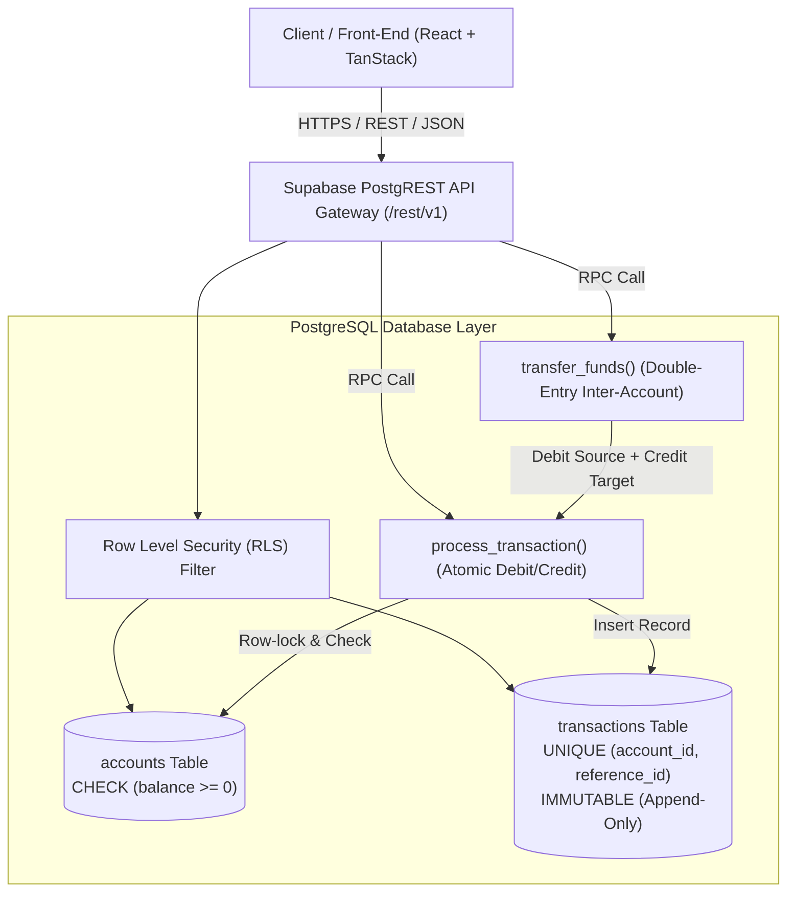

# **Transaction Ledger System — API Reference Manual**

**Document Status:** Production Reference Specification  
**Version:** 1.0.0  
**Target Gateway:** Supabase PostgREST & PostgreSQL Stored Procedures (RPC)  
**Primary Currency:** Indian Rupee (`INR` / `₹`)  
**Standard Date/Time:** ISO 8601 UTC (`YYYY-MM-DDTHH:mm:ss.sssZ`)

---

## **1. Architecture Overview**

The Transaction Ledger API executes directly at the PostgreSQL database layer via Supabase PostgREST and Remote Procedure Calls (RPCs). Business logic, balance checks, overdraft protection, and idempotency guarantees are enforced natively inside atomic database transactions (`SECURITY DEFINER` functions).



### **Core Tenets**
1. **Append-Only Immutability**: The `transactions` table permits only `INSERT` and `SELECT` via Row Level Security (RLS). No `UPDATE` or `DELETE` policies exist.
2. **Zero-Overdraft Enforcement**: The `accounts` table enforces `CHECK (balance >= 0)`. Any debit operation attempting to breach zero triggers an instant database `ROLLBACK`.
3. **Idempotency Defense**: The composite constraint `UNIQUE (account_id, reference_id)` prevents accidental replay or double-spending.
4. **Dual-Engine Operation**: Client applications can communicate with this live Supabase REST API or fall back seamlessly to the reactive client-side mock engine when environment variables are omitted.

---

## **2. Base URL & Common Headers**

### **Base URL**
* **Cloud Production**: `https://<PROJECT_REF>.supabase.co/rest/v1`
* **Local Development**: `http://localhost:54321/rest/v1`

### **Mandatory Headers**

| Header | Value | Description |
| :--- | :--- | :--- |
| `apikey` | `<SUPABASE_ANON_KEY>` | Public client anonymous authorization token. |
| `Authorization` | `Bearer <SUPABASE_ANON_KEY>` | Bearer JWT header passed to PostgREST. |
| `Content-Type` | `application/json` | Required for all `POST`, `PATCH`, and RPC requests. |
| `Prefer` *(Optional)* | `return=representation` | Instructs PostgREST to return the inserted/updated record payload. |
| `Prefer` *(Optional)* | `count=exact` | Includes the exact total count in the `Content-Range` response header. |

---

## **3. Identifier & Monetary Standards**

### **3.1 Account IDs (`ACmmXXXX`)**
Unguessable, meaningful 8-character uppercase alphanumeric strings generated by PostgreSQL:
* **Prefix**: `AC` (Account Identifier)
* **Month Code**: `mm` (2-digit month of account creation, e.g. `10` for October)
* **Entropy**: `XXXX` (4 pseudorandom alphanumeric characters from Crockford/safe Base32: `23456789ABCDEFGHJKLMNPQRSTUVWXYZ`)
* *Example*: `AC107K9P`, `AC103X8D`, `AC109M2B`

### **3.2 Reference IDs (Idempotency Keys)**
Hyphen-free alphanumeric reference identifiers used to prevent duplicate postings:
* **Internal Debit/Credit**: `INTTXN` + 6 random digits (e.g. `INTTXN102941`).
* **Inter-Account Transfers**: 
  * Base Transfer ID: `OTHERACC` + 6 digits (e.g. `OTHERACC202001`).
  * **Debit Leg (Source)**: Suffix `dr` $\rightarrow$ `OTHERACC202001dr`.
  * **Credit Leg (Destination)**: Suffix `cr` $\rightarrow$ `OTHERACC202001cr`.

### **3.3 Monetary Amounts**
* **Type**: `NUMERIC` / `NUMERIC(15,2)`.
* **Currency**: Indian Rupee (`INR` / `₹`).
* **Validation**: Strictly positive (`amount > 0`). Fractional amounts represent paise (2 decimal digits).

---

## **4. API Endpoints Reference**

| Method | Endpoint | Description | Auth / Security |
| :--- | :--- | :--- | :--- |
| `GET` | `/accounts` | List all registered accounts with balance and creation date | RLS (Public read) |
| `POST` | `/accounts` | Create a new ledger account (initial balance: `0.00`) | RLS (Insert) |
| `GET` | `/accounts?id=eq.{id}` | Inquire single account details and current balance | RLS (Public read) |
| `GET` | `/transactions` | Query ledger transactions (filtering, pagination, sorting) | RLS (Public read) |
| `POST` | `/rpc/process_transaction` | Atomic single-account credit (deposit) or debit (withdrawal) | `SECURITY DEFINER` |
| `POST` | `/rpc/transfer_funds` | Atomic double-entry transfer between two accounts | `SECURITY DEFINER` |

---

## **5. Detailed Endpoint Specifications**

### **5.1 Inquire / List Accounts**
Retrieve all ledger accounts, or filter by specific criteria.

* **Method**: `GET`
* **Path**: `/rest/v1/accounts`
* **Query Parameters**:
  * `select`: Comma-separated columns (e.g. `*` or `id,name,balance,created_at`).
  * `id`: Filter by equality (e.g. `id=eq.AC107K9P`).
  * `order`: Sort column and direction (e.g. `created_at.desc` or `balance.desc`).
  * `limit`: Page size limit (e.g. `10`).
  * `offset`: Pagination offset (e.g. `0`).

#### **Request Example**
```bash
curl -X GET 'https://<PROJECT_REF>.supabase.co/rest/v1/accounts?select=*&order=created_at.desc' \
  -H 'apikey: <ANON_KEY>' \
  -H 'Authorization: Bearer <ANON_KEY>'
```

#### **Success Response (`200 OK`)**
```json
[
  {
    "id": "AC107K9P",
    "name": "Operating Treasury",
    "balance": 1000.00,
    "created_at": "2026-10-01T08:30:00.000Z"
  },
  {
    "id": "AC103X8D",
    "name": "Strategic Investment Reserve",
    "balance": 3500.00,
    "created_at": "2026-10-05T10:15:00.000Z"
  },
  {
    "id": "AC109M2B",
    "name": "New Corporate Escrow",
    "balance": 0.00,
    "created_at": "2026-10-12T14:45:00.000Z"
  }
]
```

---

### **5.2 Create New Account**
Registers a new ledger account. Initial balance is strictly initialized to `0.00`.

* **Method**: `POST`
* **Path**: `/rest/v1/accounts`
* **Headers**:
  * `Prefer: return=representation` (returns the created account)
* **Request Body**:
  ```json
  {
    "name": "Discretionary Liquidity Fund"
  }
  ```
  *(Note: `id` is generated automatically via `generate_account_id()`, `balance` defaults to `0.00`, and `created_at` defaults to `now()`)*

#### **Request Example**
```bash
curl -X POST 'https://<PROJECT_REF>.supabase.co/rest/v1/accounts' \
  -H 'apikey: <ANON_KEY>' \
  -H 'Authorization: Bearer <ANON_KEY>' \
  -H 'Content-Type: application/json' \
  -H 'Prefer: return=representation' \
  -d '{
    "name": "Discretionary Liquidity Fund"
  }'
```

#### **Success Response (`201 Created`)**
```json
[
  {
    "id": "AC104N7R",
    "name": "Discretionary Liquidity Fund",
    "balance": 0.00,
    "created_at": "2026-10-28T10:00:00.000Z"
  }
]
```

#### **Error Responses**
* **`400 Bad Request` — Missing Required Name (`23502`)**:
  ```json
  {
    "code": "23502",
    "details": "Failing row contains (AC104N7R, null, 0, 2026-10-28 10:00:00+00).",
    "hint": null,
    "message": "null value in column \"name\" of relation \"accounts\" violates not-null constraint"
  }
  ```

---

### **5.3 Query Ledger Transactions**
Fetches immutable ledger entries with support for account filtering, type filtering, sorting, and pagination.

* **Method**: `GET`
* **Path**: `/rest/v1/transactions`
* **Query Parameters**:
  * `select`: Columns or joined relations (e.g. `*` or `*,accounts(name)`).
  * `account_id`: Filter by account ID (e.g. `account_id=eq.AC107K9P`).
  * `type`: Filter by transaction leg (e.g. `type=eq.credit` or `type=eq.debit`).
  * `order`: Ordering specification (e.g. `created_at.desc`).
  * `limit`: Page count (e.g. `15`).
  * `offset`: Page offset (e.g. `0`).

#### **Request Example**
```bash
curl -X GET 'https://<PROJECT_REF>.supabase.co/rest/v1/transactions?account_id=eq.AC107K9P&order=created_at.desc&limit=5' \
  -H 'apikey: <ANON_KEY>' \
  -H 'Authorization: Bearer <ANON_KEY>' \
  -H 'Prefer: count=exact'
```

#### **Success Response (`200 OK`)**
```json
[
  {
    "id": "a1b2c3d4-e5f6-7890-abcd-ef1234567890",
    "account_id": "AC107K9P",
    "type": "credit",
    "amount": 1000.00,
    "description": "Initial Capital Allocation",
    "reference_id": "INTTXN101001",
    "created_at": "2026-10-01T09:00:00.000Z"
  },
  {
    "id": "b2c3d4e5-f6a7-8901-bcde-f12345678901",
    "account_id": "AC107K9P",
    "type": "debit",
    "amount": 300.00,
    "description": "Transfer to Strategic Investment Reserve",
    "reference_id": "OTHERACC201001dr",
    "created_at": "2026-10-08T11:20:00.000Z"
  }
]
```

---

### **5.4 Execute Single-Account Transaction (`process_transaction`)**
Atomically performs a deposit (`credit`) or withdrawal (`debit`) on an account within an isolated transaction. Updates the account balance and records the immutable transaction log.

* **Method**: `POST`
* **Path**: `/rest/v1/rpc/process_transaction`
* **Security**: `SECURITY DEFINER` (executes with elevated procedure privilege)
* **Parameters (JSON Body)**:

| Field | Type | Mandatory | Description / Validation |
| :--- | :--- | :--- | :--- |
| `p_account_id` | `TEXT` | **Yes** | 8-character Account ID (e.g. `AC107K9P`). |
| `p_type` | `TEXT` | **Yes** | Must be strictly `'credit'` or `'debit'`. |
| `p_amount` | `NUMERIC` | **Yes** | Strictly positive numeric value (`> 0`). |
| `p_description` | `TEXT` | No | Optional human-readable memo/purpose. |
| `p_reference_id` | `TEXT` | **Yes** | Hyphen-free idempotency key (e.g. `INTTXN102941`). |

#### **Request Example (Deposit / Credit)**
```bash
curl -X POST 'https://<PROJECT_REF>.supabase.co/rest/v1/rpc/process_transaction' \
  -H 'apikey: <ANON_KEY>' \
  -H 'Authorization: Bearer <ANON_KEY>' \
  -H 'Content-Type: application/json' \
  -d '{
    "p_account_id": "AC107K9P",
    "p_type": "credit",
    "p_amount": 500.00,
    "p_description": "Q3 Dividend Payout",
    "p_reference_id": "INTTXN508192"
  }'
```

#### **Success Response (`200 OK`)**
Returns the newly created transaction record:
```json
{
  "id": "c3d4e5f6-a7b8-9012-cdef-123456789012",
  "account_id": "AC107K9P",
  "type": "credit",
  "amount": 500.00,
  "description": "Q3 Dividend Payout",
  "reference_id": "INTTXN508192",
  "created_at": "2026-10-28T10:15:32.418Z"
}
```

#### **Error Responses**

* **`400 Bad Request` — Insufficient Funds / Overdraft Protection (`23514`)**:
  When a debit amount exceeds the account balance, the database `CHECK (balance >= 0)` constraint aborts the transaction immediately:
  ```json
  {
    "code": "23514",
    "details": "Failing row contains (AC107K9P, Operating Treasury, -50.00, ...).",
    "hint": null,
    "message": "new row for relation \"accounts\" violates check constraint \"accounts_balance_check\""
  }
  ```

* **`409 Conflict` — Duplicate Reference ID / Replay (`23505`)**:
  When the same `(account_id, reference_id)` is submitted twice:
  ```json
  {
    "code": "23505",
    "details": "Key (account_id, reference_id)=(AC107K9P, INTTXN508192) already exists.",
    "hint": null,
    "message": "duplicate key value violates unique constraint \"uq_account_reference\""
  }
  ```

* **`400 Bad Request` — Invalid Transaction Type (`22023`)**:
  ```json
  {
    "code": "22023",
    "details": null,
    "hint": null,
    "message": "Invalid transaction type: transfer"
  }
  ```

* **`400 Bad Request` — Non-Positive Amount (`22023`)**:
  ```json
  {
    "code": "22023",
    "details": null,
    "hint": null,
    "message": "Amount must be positive, got: -100"
  }
  ```

* **`404 / 400 Bad Request` — Account Not Found (`23503`)**:
  ```json
  {
    "code": "23503",
    "details": "Key (account_id)=(AC999999) is not present in table \"accounts\".",
    "hint": null,
    "message": "insert or update on table \"transactions\" violates foreign key constraint \"transactions_account_id_fkey\""
  }
  ```

---

### **5.5 Execute Double-Entry Inter-Account Transfer (`transfer_funds`)**
Performs an ACID-compliant fund transfer between two distinct accounts. Executes:
1. Debit leg on `source_account_id` with reference `${reference_id}dr`.
2. Credit leg on `dest_account_id` with reference `${reference_id}cr`.
3. If the source account has insufficient funds, or either reference key already exists, the entire operation is automatically rolled back. Neither account balance is modified.

* **Method**: `POST`
* **Path**: `/rest/v1/rpc/transfer_funds`
* **Security**: `SECURITY DEFINER`
* **Parameters (JSON Body)**:

| Field | Type | Mandatory | Description / Validation |
| :--- | :--- | :--- | :--- |
| `source_account_id` | `TEXT` | **Yes** | 8-character Source Account ID (Debited). |
| `dest_account_id` | `TEXT` | **Yes** | 8-character Destination Account ID (Credited). Must differ from source. |
| `amount` | `NUMERIC` | **Yes** | Transfer amount in INR (`> 0`). |
| `reference_id` | `TEXT` | **Yes** | Base transfer reference ID (e.g. `OTHERACC309182`). |

#### **Request Example**
```bash
curl -X POST 'https://<PROJECT_REF>.supabase.co/rest/v1/rpc/transfer_funds' \
  -H 'apikey: <ANON_KEY>' \
  -H 'Authorization: Bearer <ANON_KEY>' \
  -H 'Content-Type: application/json' \
  -d '{
    "source_account_id": "AC107K9P",
    "dest_account_id": "AC103X8D",
    "amount": 250.00,
    "reference_id": "OTHERACC309182"
  }'
```

#### **Success Response (`200 OK`)**
```json
{
  "status": "success",
  "reference_id": "OTHERACC309182",
  "amount": 250.00
}
```

*Behind the scenes, two immutable records were added to `transactions`:*
1. `account_id: AC107K9P`, `type: debit`, `amount: 250.00`, `reference_id: OTHERACC309182dr`
2. `account_id: AC103X8D`, `type: credit`, `amount: 250.00`, `reference_id: OTHERACC309182cr`

#### **Error Responses**

* **`400 Bad Request` — Source Account Overdraft (`23514`)**:
  ```json
  {
    "code": "23514",
    "details": "Failing row contains (AC107K9P, Operating Treasury, -50.00, ...).",
    "hint": null,
    "message": "new row for relation \"accounts\" violates check constraint \"accounts_balance_check\""
  }
  ```

* **`400 Bad Request` — Same Source and Destination Account (`22023`)**:
  ```json
  {
    "code": "22023",
    "details": null,
    "hint": null,
    "message": "Source and destination accounts must be different"
  }
  ```

* **`409 Conflict` — Replay Attack / Reused Transfer Reference (`23505`)**:
  ```json
  {
    "code": "23505",
    "details": "Key (account_id, reference_id)=(AC107K9P, OTHERACC309182dr) already exists.",
    "hint": null,
    "message": "duplicate key value violates unique constraint \"uq_account_reference\""
  }
  ```

---

## **6. Complete Error Code Matrix & Client Mapping**

The following mapping (implemented in [`src/lib/error-map.ts`](src/lib/error-map.ts)) defines how PostgreSQL engine errors translate to human-readable client statuses:

| PostgreSQL Code | HTTP Status | Root Cause | User-Facing Resolution / Message |
| :--- | :--- | :--- | :--- |
| `23514` | `400 Bad Request` | `CHECK (balance >= 0)` violation | **"Transaction Failed: Insufficient funds for this debit."** |
| `23514` | `400 Bad Request` | `CHECK (amount > 0)` violation | **"Validation Error: Amount must be greater than 0."** |
| `23505` | `409 Conflict` | `uq_account_reference` duplicate | **"Duplicate Transaction: This reference ID has already been processed."** |
| `23503` | `404 / 400` | Foreign Key violation (`account_id`) | **"Error: Invalid Account ID. The account does not exist."** |
| `23502` | `400 Bad Request` | `NOT NULL` constraint violation | **"Validation Error: Required fields are missing."** |
| `22023` | `400 Bad Request` | Custom `RAISE EXCEPTION` from RPC | Exact exception text (e.g. *"Source and destination accounts must be different"*). |
| `PGRST116` | `404 Not Found` | PostgREST `.single()` found 0 rows | **"Error: Account not found. No ledger record exists for this account ID."** |
| `401 / 403` | `401 Unauthorized` | Missing / expired API token | **"Authentication Error: Please sign in to continue."** |

---

## **7. Code Integration Examples**

### **7.1 TypeScript / JavaScript (`@supabase/supabase-js`)**

```typescript
import { createClient } from '@supabase/supabase-js'

const supabase = createClient(
  process.env.VITE_SUPABASE_URL!,
  process.env.VITE_SUPABASE_ANON_KEY!
)

// 1. Inquire Account Balance
export async function getAccountBalance(accountId: string) {
  const { data, error } = await supabase
    .from('accounts')
    .select('id, name, balance')
    .eq('id', accountId.toUpperCase())
    .single()

  if (error) throw error
  return data
}

// 2. Deposit Funds (Credit)
export async function depositFunds(accountId: string, amount: number, memo?: string) {
  const referenceId = `INTTXN${Math.floor(100000 + Math.random() * 900000)}`
  
  const { data, error } = await supabase.rpc('process_transaction', {
    p_account_id: accountId,
    p_type: 'credit',
    p_amount: amount,
    p_description: memo || null,
    p_reference_id: referenceId,
  })

  if (error) throw error
  return data
}

// 3. Inter-Account Transfer (Atomic Double-Entry)
export async function transferBetweenAccounts(
  sourceId: string,
  destId: string,
  amount: number
) {
  const baseReference = `OTHERACC${Math.floor(100000 + Math.random() * 900000)}`

  const { data, error } = await supabase.rpc('transfer_funds', {
    source_account_id: sourceId,
    dest_account_id: destId,
    amount: amount,
    reference_id: baseReference,
  })

  if (error) throw error
  return data
}
```

### **7.2 TanStack Query Hook Integration Pattern**

```typescript
import { useMutation, useQueryClient } from '@tanstack/react-query'
import { supabase } from '@/lib/supabase'

export function useProcessTransaction(accountId: string) {
  const queryClient = useQueryClient()

  return useMutation({
    mutationFn: async (params: {
      p_account_id: string
      p_type: 'credit' | 'debit'
      p_amount: number
      p_description?: string
      p_reference_id: string
    }) => {
      const { data, error } = await supabase.rpc('process_transaction', params)
      if (error) throw error
      return data
    },
    onSuccess: () => {
      // Invalidate caches to trigger real-time reactive UI update
      queryClient.invalidateQueries({ queryKey: ['accounts'] })
      queryClient.invalidateQueries({ queryKey: ['account', accountId] })
      queryClient.invalidateQueries({ queryKey: ['transactions', accountId] })
    },
  })
}
```

---

## **8. Concurrency, Locking & Atomicity Guarantees**

1. **Serialized Account Updates**:  
   During `process_transaction`, the SQL command `UPDATE accounts SET balance = balance ... WHERE id = p_account_id` establishes an exclusive row-level lock (`SELECT ... FOR UPDATE` behavior) on the target account row until transaction commit.
2. **Transfer Deadlock Avoidance**:  
   In `transfer_funds`, operations always process the debit leg followed by the credit leg. Under high concurrent bidirectional transfers between Account A and Account B, transactions are wrapped inside standard PostgreSQL transaction isolation with automatic rollback on serialization failures.
3. **Audit Trail Completeness**:  
   Because both legs of a transfer generate explicit rows in `transactions` with corresponding `dr` and `cr` suffixes, balance recalculation via `SUM(CASE WHEN type = 'credit' THEN amount ELSE -amount END)` mathematically equals `accounts.balance` at all times.
