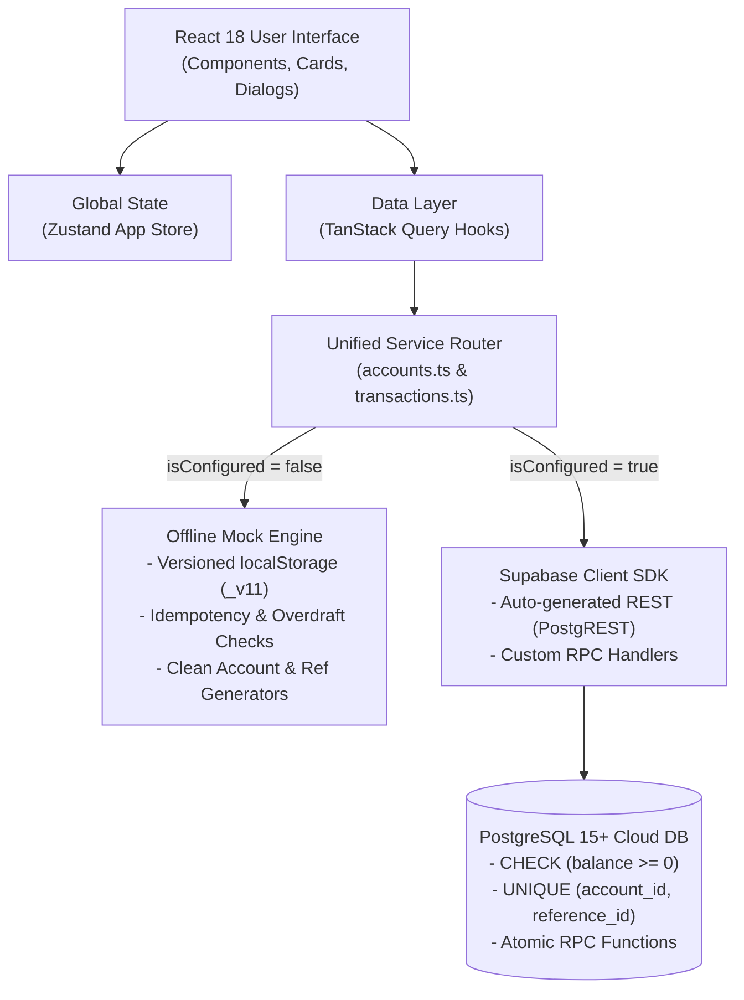

# **Transaction Ledger System — System Architecture & Specification**

**Document Status:** Current Production Specification  
**Version:** 1.0.0  
**Target Architecture:** Dual-Engine (Client-Side Reactive Mock & PostgreSQL Database-Driven API via Supabase)  
**Primary Currency:** Indian Rupee (₹ / INR)

---

## **1. System Overview**

The Transaction Ledger System is an enterprise-grade financial ledger and treasury tracking platform engineered with:
1. **Strict Overdraft Protection**: Guaranteed prevention of negative account balances at both the PostgreSQL constraint layer and frontend validation layers.
2. **Atomic Double-Entry Transfers**: ACID-compliant inter-account fund transfers executing simultaneous debit and credit legs within an isolated transaction.
3. **Idempotency & Replay Defense**: Per-account reference ID uniqueness (`UNIQUE (account_id, reference_id)`) preventing duplicate transactions or network replay attacks.
4. **Dual-Engine Execution**: Seamless zero-configuration offline mock ledger for instant local execution alongside production-ready Supabase cloud connectivity.
5. **Hyphen-Free Auditable Identifiers**: Standardized 8-character unguessable Account IDs (`ACmmXXXX`) and clean reference IDs (`INTTXNXXXXXX` and `OTHERACCXXXXXXdr/cr`).

---

## **2. Technical Stack & Role Mapping**

| Technology | Version | Implementation Role |
| :--- | :--- | :--- |
| **React** | `18.3.1` | Core declarative UI library with Concurrent Mode rendering. |
| **TypeScript** | `5.6.3` | End-to-end type safety, domain contracts, and schema synchronization. |
| **Vite** | `6.0.1` | Build tooling, fast HMR dev server, and Rollup bundling. |
| **Tailwind CSS** | `v4.0.0` | Modern CSS-first design token architecture, fluid typography, and custom micro-interactions. |
| **TanStack Query** | `v5.62.7` | Asynchronous server-state synchronization, cache management, and reactive mutations. |
| **TanStack Router** | `v1.81.3` | Type-safe file-based client routing (`/accounts`, `/accounts/$id`). |
| **Zustand** | `v5.0.2` | Lightweight global UI state (modals, active account, transaction filters, pagination). |
| **Supabase (PostgreSQL 15+)** | `2.46.2` | Production API, Row Level Security (RLS), and atomic stored procedure execution. |
| **React Hook Form + Zod** | `7.54 / 3.23` | Schema validation, type inference, and resilient client-side form controls. |
| **Lucide React** | `0.468.0` | Accessible vector iconography across ledger cards, dialogs, and navigation. |

---

## **3. Dual-Engine Architecture**

The system employs an automatic environment detection layer ([`src/lib/supabase.ts`](src/lib/supabase.ts)):



- **Sandbox / Offline Mock Mode**: Active when `.env.local` is missing, empty, or contains default placeholders. Pre-seeded with realistic initial ledgers (`AC107K9P`, `AC103X8D`, `AC109M2B`), persisting full transactional histories in versioned browser `localStorage`.
- **Cloud PostgreSQL Mode**: Activated automatically when valid `VITE_SUPABASE_URL` and `VITE_SUPABASE_ANON_KEY` are provided. Routes all operations directly to PostgreSQL RPC stored procedures with RLS.

---

## **4. Data Architecture & Integrity Constraints**

### **4.1 accounts Table**

| Column | Type | Constraints / Rules |
| :---- | :---- | :---- |
| `id` | `TEXT` | **Primary Key**. 8-character unguessable alphanumeric format `ACmmXXXX` (e.g. `AC107K9P`). |
| `name` | `TEXT` | `NOT NULL`. Trims whitespace, minimum 2 characters. |
| `balance` | `NUMERIC(14,2)` | `DEFAULT 0.00`. **Critical Check Constraint:** `CHECK (balance >= 0)` natively blocking overdrafts. |
| `created_at` | `TIMESTAMPTZ` | `NOT NULL DEFAULT now()`. Read-only audit timestamp. |

### **4.2 transactions Table**

| Column | Type | Constraints / Rules |
| :---- | :---- | :---- |
| `id` | `UUID` | **Primary Key**. Defaults to `uuid_generate_v4()`. |
| `account_id` | `TEXT` | `NOT NULL REFERENCES accounts(id) ON DELETE RESTRICT`. |
| `type` | `TEXT` | `NOT NULL CHECK (type IN ('credit', 'debit'))`. |
| `amount` | `NUMERIC(14,2)` | `NOT NULL CHECK (amount > 0)`. Zero and negative amounts rejected. |
| `description` | `TEXT` | Optional narrative detail. |
| `reference_id` | `TEXT` | `NOT NULL`. Hyphen-free format (`INTTXN...` or `OTHERACC...dr/cr`). |
| `created_at` | `TIMESTAMPTZ` | `NOT NULL DEFAULT now()`. Immutable audit timestamp. |

### **4.3 Immutability & Idempotency Rules**
- **Row Level Security (RLS)**: `transactions` table permits `INSERT` and `SELECT`. `UPDATE` and `DELETE` operations are completely revoked at the database layer.
- **Per-Account Scoped Uniqueness**:
  ```sql
  CONSTRAINT uq_account_reference UNIQUE (account_id, reference_id)
  ```
  Prevents duplicate posting while allowing inter-account transfers to share identical base transaction references across distinct accounts.

---

## **5. Standardized Ledger Identifiers**

### **5.1 Account IDs (Option 1 Standard)**
All account identifiers are strictly 8 characters:
```
AC + [2-Digit Current Month] + [4-Character Unguessable Key]
```
- **Example**: `AC107K9P`, `AC103X8D`, `AC109M2B`
- **Charset**: `23456789ABCDEFGHJKLMNPQRSTUVWXYZ` (excludes visually ambiguous `0/O` and `1/I`).
- **Initial Account Balance**: Strictly **`₹0.00`** upon creation.

### **5.2 Reference IDs (Hyphen-Free Standard)**
All transaction references are clean, alphanumeric, and completely hyphen-free:
- **Internal Transactions (Single Account)**:
  - Format: `INTTXN` + 6 random digits (e.g. `INTTXN101001`, `INTTXN305733`)
- **Inter-Account Transfers (Two Accounts)**:
  - Base Transfer ID: `OTHERACC` + 6 random digits (e.g. `OTHERACC202001`)
  - **Debit Leg (Source)**: Suffix `dr` $\rightarrow$ `OTHERACC202001dr`
  - **Credit Leg (Destination)**: Suffix `cr` $\rightarrow$ `OTHERACC202001cr`
- **Automatic Sanitizer**: The utility [`formatCleanReferenceId`](src/lib/reference.ts) guarantees legacy hyphenated references automatically normalize in all table rows, modals, and persistence layers.

---

## **6. API & RPC Specification**

### **6.1 Create Account**
- **Endpoint**: `POST /rest/v1/accounts` (or `mockAccountsService.create`)
- **Payload**:
  ```json
  { "name": "Corporate Treasury Reserve" }
  ```
- **Logic**: Automatically assigns 8-char ID `ACmmXXXX`, forces initial balance to `0.00`, sets `created_at` to current timestamp.

### **6.2 Process Transaction (Atomic Single Account)**
- **Endpoint**: `POST /rest/v1/rpc/process_transaction` (or `mockTransactionsService.process`)
- **Parameters**:
  - `p_account_id`: `TEXT` (Target Account ID)
  - `p_type`: `'credit' | 'debit'`
  - `p_amount`: `NUMERIC` (> 0)
  - `p_description`: `TEXT` (Optional)
  - `p_reference_id`: `TEXT` (Clean Reference ID)
- **Database Logic**:
  1. Acquires row lock: `SELECT balance FROM accounts WHERE id = p_account_id FOR UPDATE;`
  2. Verifies account existence; throws `PGRST116` if not found.
  3. Validates debit sufficiency (`current_balance - p_amount >= 0`).
  4. Inserts immutable record into `transactions`.
  5. Updates `accounts.balance` atomically.

### **6.3 Transfer Funds (Atomic Inter-Account Double-Entry)**
- **Endpoint**: `POST /rest/v1/rpc/transfer_funds` (or `mockTransactionsService.transfer`)
- **Parameters**:
  - `source_account_id`: `TEXT`
  - `dest_account_id`: `TEXT`
  - `amount`: `NUMERIC` (> 0)
  - `reference_id`: `TEXT` (Base Reference ID)
- **Database Logic**:
  1. Validates `source_account_id != dest_account_id`.
  2. Executes debit on source account with `reference_id || 'dr'`.
  3. Executes credit on destination account with `reference_id || 'cr'`.
  4. Commits both operations as a single ACID transaction; any check violation immediately triggers complete rollback.

### **6.4 Balance Inquiry & Check Balance Modal**
- **Client Flow**: Standalone inquiry dialog allowing users to enter an 8-character Account ID or select an existing ledger. Auto-detects and confirms the holder name on match, then opens the dedicated `CompletionDialog` to present verified real-time balance and ledger status.

### **6.5 Transaction History with Server-Side Pagination**
- **Query**:
  ```
  GET /rest/v1/transactions?account_id=eq.AC107K9P&order=created_at.desc&limit=5&offset=0
  Headers: Prefer: count=exact
  ```
- **Filters**:
  - `All`: Returns complete chronological ledger history.
  - `Credit`: Filters exclusively to incoming deposits (`type = 'credit'`).
  - `Debit`: Filters exclusively to outgoing withdrawals/transfers (`type = 'debit'`).

---

## **7. User Experience & Mobile Ergonomics**

- **Dynamic Viewport Height (`100dvh`)**: All modals use `max-h-[calc(100dvh-1.5rem)]` and vertical flex layouts with fixed headers and scrollable bodies, preventing mobile browser address bar clipping.
- **Zero Truncation**: Account verification cards adapt fluidly across small displays without cutting off account holder names or balances.
- **Thumb-Friendly Touch Targets**: Primary action buttons feature responsive sizing (`flex-1 sm:flex-initial`) with minimum 44px touch targets.
- **Live Overdraft Indicators**: Instant real-time feedback warns users before submission if debit amounts exceed current available balances.

---

## **8. Database Migration Files**

Migrations located in [`supabase/`](supabase/):
1. [`01_extensions.sql`](supabase/01_extensions.sql) — Initializes UUID extensions.
2. [`02_accounts.sql`](supabase/02_accounts.sql) — Creates `accounts` table with `CHECK (balance >= 0)`.
3. [`03_transactions.sql`](supabase/03_transactions.sql) — Creates `transactions` table with foreign keys and unique constraints.
4. [`04_rls.sql`](supabase/04_rls.sql) — Configures Row Level Security immutability rules.
5. [`05_rpc_process_transaction.sql`](supabase/05_rpc_process_transaction.sql) — Stored procedure for atomic single-account mutations with row locking.
6. [`06_rpc_transfer_funds.sql`](supabase/06_rpc_transfer_funds.sql) — Stored procedure for atomic double-entry inter-account transfers.
7. [`07_indexes.sql`](supabase/07_indexes.sql) — Indexes on account IDs, reference IDs, and timestamps.
8. [`08_seed.sql`](supabase/08_seed.sql) — Clean seed records with Option 1 account IDs and hyphen-free references.

---

## **9. Related Documentation**

- **[`API.md`](API.md)** — Detailed API Reference Manual with PostgREST schemas, RPC parameters, error codes, and curl/SDK code samples.
- **[`README.md`](README.md)** — Developer Quickstart guide, local setup instructions, and architecture breakdown.
- **[`DESIGN.md`](DESIGN.md)** — Design tokens, color system, and UI layout rules.
