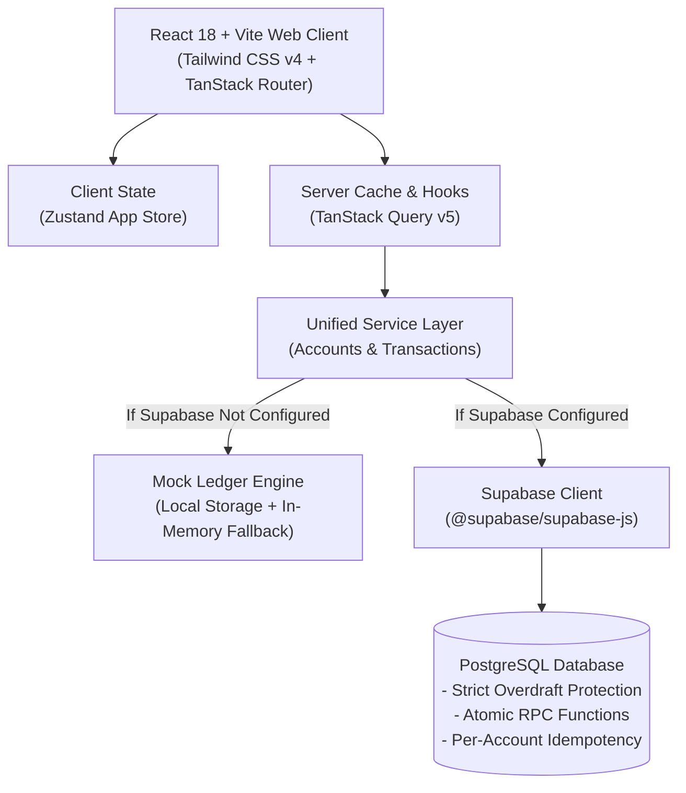

# Transaction Ledger

[](https://react.dev/)
[](https://www.typescriptlang.org/)
[](https://vitejs.dev/)
[](https://tailwindcss.com/)
[](https://tanstack.com/query)
[](https://tanstack.com/router)
[](https://zustand-demo.pmnd.rs/)
[](https://supabase.com/)

An enterprise-grade, immutable double-entry transaction ledger and treasury management system. Engineered with strict overdraft protection, idempotent transaction processing, atomic inter-account transfers, and real-time ledger verification.

---

## Table of Contents
- [Architecture Overview](#architecture-overview)
- [Key Features](#key-features)
- [Quick Start (Local Run in Under 2 Minutes)](#quick-start-local-run-in-under-2-minutes)
- [Dual-Engine Architecture (Offline Mock vs. Supabase Cloud)](#dual-engine-architecture)
- [Database Setup (Optional: PostgreSQL via Supabase)](#database-setup-optional-postgresql-via-supabase)
- [Ledger Conventions & Standards](#ledger-conventions--standards)
  - [Account ID Format (Option 1)](#account-id-format)
  - [Reference ID Format](#reference-id-format)
- [Project Structure](#project-structure)
- [Scripts & Verification](#scripts--verification)
- [License](#license)

---

## Architecture Overview



---

## Key Features

- **Strict Overdraft Protection**: Guaranteed prevention of negative balances at both the database level (`CHECK (balance >= 0)`) and frontend validation layer.
- **Atomic Money Transfers**: ACID-compliant inter-account transfers via stored procedures executing debit and credit legs simultaneously.
- **Idempotent Processing**: Scoped uniqueness constraint `UNIQUE (account_id, reference_id)` preventing duplicate processing or replay attacks.
- **Clean Ledger Reference IDs**:
  - **Internal Transactions**: `INTTXNXXXXXX` (e.g. `INTTXN101001`)
  - **Inter-Account Transfers**: `OTHERACCXXXXXXdr` (debit leg) and `OTHERACCXXXXXXcr` (credit leg)
- **Standardized Account IDs**: 8-character unguessable alphanumeric format `ACmmXXXX` (e.g. `AC107K9P`).
- **Real-Time Balance Inquiries**: Standalone account lookup modal with auto-detection of account holder names and instant status reporting.
- **Zero-Setup Local Dev**: Fully operational in offline mock mode right after cloning — no API keys or cloud credentials required to run and test immediately.

---

## Quick Start (Local Run in Under 2 Minutes)

You can launch and interact with the full application immediately using the built-in mock ledger engine.

### Prerequisites
- **Node.js**: v18.0.0 or higher
- **npm**: v9.0.0 or higher

### Step 1: Clone the Repository
```bash
git clone <repository-url>
cd Tl_Api
```

### Step 2: Install Dependencies
```bash
npm install
```

### Step 3: Start the Development Server
```bash
npm run dev
```

### Step 4: Open in Your Browser
Navigate to:
```
http://localhost:5173
```

The application will launch in **Mock Ledger Engine Mode**, pre-populated with:
- **Operating Treasury (`AC107K9P`)**: Initial balance `₹1,000.00` with 6 paginated transactions.
- **Strategic Investment Reserve (`AC103X8D`)**: Balance `₹500.00`.
- **New Corporate Escrow (`AC109M2B`)**: Balance `₹0.00`.

All actions (deposits, withdrawals, balance checks, creating accounts, and transfers) are completely functional and persist locally in browser storage.

---

## Dual-Engine Architecture

The Transaction Ledger application employs an automatic environment detection layer ([`src/lib/supabase.ts`](file:///Users/shafi/WEE/Tl_Api/src/lib/supabase.ts)):

| Mode | Trigger Condition | Backing Store | Ideal For |
| :--- | :--- | :--- | :--- |
| **Offline Mock Mode** | Missing, blank, or placeholder `.env.local` keys | Browser `localStorage` with versioned cache | Local development, rapid UI reviews, CI runs, offline demos |
| **Cloud PostgreSQL Mode** | Valid `VITE_SUPABASE_URL` and `VITE_SUPABASE_ANON_KEY` | Supabase managed PostgreSQL with RPC functions & RLS | Production staging, shared multi-user testing, persistent cloud ledger |

---

## Database Setup (Optional: PostgreSQL via Supabase)

To connect the application to a live Supabase PostgreSQL database:

### 1. Create a Supabase Project
1. Log in to [supabase.com](https://supabase.com/) and create a new project.
2. Note your **Project URL** and **Anon API Key** from **Project Settings > API**.

### 2. Configure Environment Variables
Create or edit `.env.local` in the project root:
```env
VITE_SUPABASE_URL=https://<your-project-id>.supabase.co
VITE_SUPABASE_ANON_KEY=<your-anon-key>
```

### 3. Run Database Migrations in Order
In your Supabase Dashboard, open the **SQL Editor** and execute the migration files located in [`supabase/`](file:///Users/shafi/WEE/Tl_Api/supabase/):

1. **[`01_extensions.sql`](file:///Users/shafi/WEE/Tl_Api/supabase/01_extensions.sql)** — Enables `uuid-ossp` extension.
2. **[`02_accounts.sql`](file:///Users/shafi/WEE/Tl_Api/supabase/02_accounts.sql)** — Creates `accounts` table with strict `balance >= 0` check.
3. **[`03_transactions.sql`](file:///Users/shafi/WEE/Tl_Api/supabase/03_transactions.sql)** — Creates `transactions` table with `uq_account_reference` constraint.
4. **[`04_rls.sql`](file:///Users/shafi/WEE/Tl_Api/supabase/04_rls.sql)** — Configures Row Level Security (RLS) policies.
5. **[`05_rpc_process_transaction.sql`](file:///Users/shafi/WEE/Tl_Api/supabase/05_rpc_process_transaction.sql)** — Creates atomic transaction processor with row locking (`FOR UPDATE`).
6. **[`06_rpc_transfer_funds.sql`](file:///Users/shafi/WEE/Tl_Api/supabase/06_rpc_transfer_funds.sql)** — Creates inter-account fund transfer RPC with `dr`/`cr` tagging.
7. **[`07_indexes.sql`](file:///Users/shafi/WEE/Tl_Api/supabase/07_indexes.sql)** — Optimizes query lookups and sorting indexes.
8. **[`08_seed.sql`](file:///Users/shafi/WEE/Tl_Api/supabase/08_seed.sql)** *(Optional)* — Seeds sample accounts and transaction history.

### 4. Restart the Dev Server
```bash
npm run dev
```
The application will automatically detect the Supabase connection and route all transactions through PostgreSQL.

---

## Ledger Conventions & Standards

### Account ID Format
All accounts strictly follow the **Option 1 Format**:
```
AC + [2-Digit Month] + [4-Character Random Alphanumeric]
```
- **Length**: Exactly 8 characters (e.g. `AC107K9P`, `AC103X8D`, `AC109M2B`).
- **Charset**: `23456789ABCDEFGHJKLMNPQRSTUVWXYZ` (excludes confusing `0`/`O` and `1`/`I`).
- **New Accounts**: Mandatory initial balance of strictly **`₹0.00`**.

### Reference ID Format
Reference IDs are hyphen-free, alphanumeric tokens designed for clean auditability:
- **Internal Transactions (Single Account)**:
  - `INTTXN` + 6-digit random code
  - *Example*: `INTTXN101001`, `INTTXN849201`
- **Inter-Account Transfers (Two Accounts)**:
  - Base transfer code: `OTHERACC` + 6-digit code (e.g. `OTHERACC202001`)
  - **Debit Leg (Source Account)**: Appended with `dr` (e.g. `OTHERACC202001dr`)
  - **Credit Leg (Destination Account)**: Appended with `cr` (e.g. `OTHERACC202001cr`)
  - Both legs share the same base reference for end-to-end reconciliation while remaining unique per account.

---

## Project Structure

```
Tl_Api/
├── src/
│   ├── components/
│   │   ├── cards/          # HeroBalanceCard, StatCard, AccountCard
│   │   ├── dialogs/        # CreateAccount, AddTransaction, Transfer, CheckBalance, CompletionDialog
│   │   ├── layout/         # AppShell, Sidebar, TopBar
│   │   ├── transactions/   # TransactionTable, FilterBar, PaginationBar, TransactionRow
│   │   └── ui/             # Dialog, Dropdown, and primitive components
│   ├── hooks/              # useAccounts, useTransactions, useToastNotify
│   ├── lib/                # currency, error-map, mock-data, reference, supabase, schemas
│   ├── routes/             # TanStack Router file-based pages (/accounts, /accounts/$id)
│   ├── services/           # Unified API services for Accounts and Transactions
│   ├── store/              # Zustand global application store (modals, filters, active account)
│   └── types/              # Domain TypeScript types
├── supabase/               # PostgreSQL schema migrations (01 through 08)
├── public/                 # Static web assets
├── .env.example            # Template for environment variables
├── package.json            # Node.js dependencies and scripts
├── vite.config.ts          # Vite build configuration with Tailwind v4 & TanStack plugins
└── tsconfig.json           # TypeScript configuration
```

---

## Scripts & Verification

| Command | Action |
| :--- | :--- |
| `npm run dev` | Starts local Vite development server with HMR at `http://localhost:5173/` |
| `npm run build` | Runs TypeScript compiler (`tsc -b`) and produces production build in `dist/` |
| `npm run preview` | Previews production build locally |
| `npm run lint` | Runs ESLint analysis across codebase |

To verify the project is healthy at any time:
```bash
npm run build
```

---

## License

This project is licensed under the MIT License.
